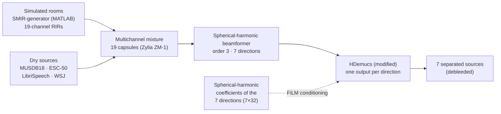
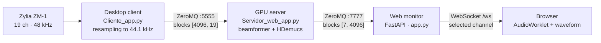

# AI Universal Debleeder: Real-Time Source Separation with a Spherical Microphone Array

Deep-learning system that removes **bleed** (crosstalk between sources) from recordings made with a spherical microphone array. A spherical-harmonic beamformer points the **Zylia ZM-1** array at 7 directions, and a modified **HDemucs** network cleans each beam so that every output contains only the source in that direction. The model is trained on many randomly simulated rooms to generalise across acoustic environments, and it runs in **near real time**, processing audio in blocks of about 93 ms on a GPU server, with desktop and web clients for live monitoring.

Bachelor's thesis (TFG) in Telecommunication Technologies Engineering, University of Jaén (EPS Linares), July 2026. Original title: *Desarrollo y entrenamiento de un debleeder universal mediante aprendizaje profundo y entrenamiento multientorno*.

## Pipeline



1. **Simulation.** Room impulse responses (RIRs) are generated for randomly sized rooms (5.5–20 m × 5.5–20 m × 3.5–6 m, RT60 0.2–1 s) with a virtual array that replicates the 19 capsules and the 4.9 cm radius of the Zylia ZM-1.
2. **Mixing.** Dry sources from four datasets are convolved with the RIRs and summed. Each mixture has up to 7 sources placed every 50° in azimuth.
3. **Beamforming.** A maximum-directivity beamformer in the spherical-harmonic domain (order 3) produces 7 directional signals, one per position.
4. **Neural debleeding.** HDemucs removes the residual bleed that the beamformer cannot suppress. Empty positions are zero-padded, and the SDR metric ignores silent channels through an RMS threshold.

## Models

All models share the same data pipeline, configuration and training loop and are selected with `train.py --model`.

| Model | `--model` | Description | Checkpoint in the thesis |
|---|---|---|---|
| Initial | `base` | HDemucs on the 7 beamformer outputs, trained for 200 epochs. Used by the real-time apps. | `version_12` |
| Without permutation | `spatial` + `permute_sources: false` | Updated dataset (no empty layouts, zero padding) | `version_23` |
| With permutation | `spatial` + `permute_sources: true` | Sources are randomly permuted across the 7 positions during training | `version_28` |
| FiLM | `film` | Spherical-harmonic coefficients of the 7 directions (7 × 32) injected into the HDemucs bottleneck through FiLM layers, with a 20× learning rate and no weight decay for those layers | `version_7` |

### Modified HDemucs

The network uses a modified copy of [Demucs](https://github.com/facebookresearch/demucs) in [`src/demucs/`](src/demucs) (MIT License, Meta Platforms). Standard HDemucs returns every input channel for every source, `[batch, sources, channels, time]`. This version returns only channel *i* for source *i*, `[batch, sources, time]`, so each output is the cleaned beam of its own direction. See [`src/demucs/MODIFICATIONS.md`](src/demucs/MODIFICATIONS.md).

> Do **not** `pip install demucs`: the scripts import the modified copy from `src/`.

## Results

**Real-time context window** (Table 4.6 of the thesis). The model was evaluated on a continuous 60 s mixture of three MUSDB18 vocal tracks with a hop of 4096 samples (≈93 ms at 44.1 kHz), varying the context fed to the network:

| Context (s) | 5.0 | 3.0 | 1.0 | 0.5 |
|---|---|---|---|---|
| SDR (dB) | 14.738 | 14.822 | **14.876** | 14.743 |

A 1 s context was chosen for the real-time apps. [`results/`](results) also contains a per-segment evaluation at 50 ms latency (`resultados_baja_latencia_*.csv`).

**FiLM conditioning test** (Table 5.1, model trained for 100 epochs). The spherical-harmonic conditioning is replaced with that of another mixture (permuted) or with random noise:

| Scenario | Mixtures | SDR normal | SDR permuted | SDR random |
|---|---|---|---|---|
| Same source type | 150 | 5.835 dB | 5.901 dB | 5.356 dB |
| Different source types | 50 | 9.284 dB | 9.028 dB | 8.831 dB |

Random conditioning degrades the SDR by about 0.45–0.48 dB, so the network uses the magnitude of the coefficients. Permuting them barely changes the result, which is expected because they are injected as a flattened 224-dimensional vector.

Training curves for the four models are in [`results/training_curves/`](results/training_curves). The BSS-eval boxplot for RIRs measured at the Conservatorio Profesional de Música de Linares is in [`results/figures/`](results/figures).

## Repository structure

```
.
├── train.py                 Unified training script (base / spatial / film)
├── configs/conf.yaml        Model, optimizer, dataset and training configuration
├── src/
│   ├── SH.py                Spherical harmonics and beamformer
│   ├── MyDataset_3_RoPE.py  Training dataset (beamformed mixtures + SH coefficients)
│   ├── MyDataset_2.py       Evaluation dataset (raw 19-channel mixtures)
│   ├── MyDataset_3_permut.py
│   ├── LightingModel2.py    LightningModule of the initial model
│   ├── Lighting_model_sinfilm.py   LightningModule with/without permutation
│   ├── LightingModel3_RoPE.py      FiLM-conditioned HDemucs
│   ├── lightingModel_3_permut.py   Evaluation module for the permutation model
│   ├── LossFunction.py      Additional losses
│   └── demucs/              Modified Demucs (MIT)
├── evaluation/              SDR, latency and artefact evaluation, FiLM test
├── plots/                   Figure generation from TensorBoard exports
├── results/                 Training curves, latency results and figures
├── apps/
│   ├── local/               All-in-one desktop app (array + GPU on the same machine)
│   ├── network/             Desktop client + GPU inference server (ZeroMQ)
│   └── web_monitor/         Browser monitor (FastAPI + WebSocket + AudioWorklet)
├── data/info/              Mixture and RIR CSV manifests of the thesis
├── data_generation/        MATLAB room/RIR simulation (Zylia ZM-1)
├── cluster/run_train.sh     Slurm training job
└── experimental/            HTDemucs + FiLM variant (not part of the thesis results)
```

## Installation

Python 3.10+ and an NVIDIA GPU are recommended (the thesis used an A100 80 GB).

```bash
python -m venv .venv && source .venv/bin/activate
pip install torch torchaudio            # choose the build for your CUDA version
pip install -r requirements.txt
```

## Data preparation

The audio datasets and simulated RIRs are **not included**: some licences forbid redistribution and the files are very large. Obtain them from their sources:

| Dataset | Content | Access |
|---|---|---|
| [MUSDB18](https://sigsep.github.io/datasets/musdb.html) | Music stems | Research use, on request via Zenodo |
| [ESC-50](https://github.com/karolpiczak/ESC-50) | Environmental sounds | CC BY-NC 3.0 |
| [LibriSpeech](https://www.openslr.org/12) | Read speech | CC BY 4.0 |
| [WSJ0 / WSJ1](https://catalog.ldc.upenn.edu/LDC93S6A) | Read speech | Licensed by the LDC |

RIRs are simulated in MATLAB with the scripts in [`data_generation/`](data_generation), built on Julio Carabias' SMIR Simulator and the [SMIR-generator](https://github.com/ehabets/SMIR-Generator), using the Zylia ZM-1 capsule positions and a 4.9 cm radius. Each RIR is a `.mat` file with a variable `sim_rir` of shape `[19, length]`.

The exact mixtures used in the thesis are versioned in [`data/info/`](data/info), so they can be rebuilt once the audio and RIRs are available:

| Set | Mixtures | Rooms | T60 (s) | Mixture CSV | RIR info |
|---|---|---|---|---|---|
| Training | 3600 | 320 | 0.2–1.0 | `train_mixtures.csv` | `train_rir_info.csv` |
| Standard validation | 1080 | 80 | 0.22–1.0 | `val_estandar_mixtures.csv` | `val_rir_info.csv` |
| Small, low reverberation | 1080 | 80 | 0.08–0.15 | `val_poco_reverb_mixtures.csv` | `val2_rir_info_salaspocoreverberantespeque.csv` |
| Large, reverberant | 1080 | 80 | 1.1–1.4 | `val_reverb_mixtures.csv` | `val3_rir_info_salas_reverberantes.csv` |

Each mixture has 2–7 sources from MUSDB18, ESC-50, WSJ and LibriSpeech. `train_mixtures_filtrado.csv` is the training set without the 7-source mixtures (3097 mixtures), and `latency_test_mixture_60s.csv` is the 60 s mixture of the real-time study.

Expected layout (paths are set in `configs/conf.yaml`, plus the `AUDIO_ROOT` environment variable for the audio folder; only `data/info/` is in the repository):

```
data/
├── BBDD/        audio datasets (AUDIO_ROOT, default ./data/BBDD)
├── rirs/        simulated RIRs (rir/roomX_Y.mat)
└── info/        mixture and RIR CSVs (included)
```

Each mixture CSV has one row per source:

| Column | Description |
|---|---|
| `mixture_id` | Rows with the same id are mixed together (up to 7) |
| `source_filepath` | Audio file; paths starting with `./` are relative to `AUDIO_ROOT` |
| `start_second` | Start of the excerpt (5 s chunks by default) |
| `rir_filepath` | RIR file, relative to `rir_root_dir` |
| `rir_elevation`, `rir_azimuth` | Source direction in radians |
| `source_class` | Source label (used to group results) |

## Training

```bash
python train.py --model base      # initial model
python train.py --model spatial   # set train.permute_sources in the config
python train.py --model film      # FiLM conditioning
```

Checkpoints and TensorBoard logs are written to `lightning_logs/` (`tensorboard --logdir lightning_logs`). The best checkpoint is selected by the SDR on the standard validation set. Add `--fast-dev-run` to check the setup with a single batch. On a Slurm cluster: `sbatch --gres=gpu:1 cluster/run_train.sh film`.

> `train.py` merges the per-model training scripts used during the thesis, which differed only in their imports. Training settings are unchanged. It has been checked with one training and validation step per model on synthetic data, not with a full training run.

## Evaluation

Scripts in `evaluation/` take the checkpoint as an argument or through the `CKPT_PATH` environment variable:

```bash
# Real-time evaluation (sliding window + overlap-add) on 60 s mixtures
python evaluation/eval_rt_v2.py --csv data/info/latency_test_mixture_60s.csv --ckpt path/to/model.ckpt --context 1.0
# Latency / context-size study
python evaluation/latencia.py --csv data/info/latency_test_mixture_60s.csv --ckpt path/to/model.ckpt
# FiLM conditioning test (Table 5.1)
CKPT_PATH=path/to/film.ckpt python evaluation/Prueba_modelo_FILM.py
```

`Creador_prueba_bajalat.py` builds the 60 s test mixtures. `eval_artefactos.py` and `generar_mezcla_pt.py` analyse artefacts on a cached mixture.

## Real-time applications

Audio is processed in blocks of 4096 samples (≈93 ms) with a 1 s context. The 19 Zylia channels are captured at 48 kHz through ASIO and resampled to 44.1 kHz.

### All-in-one desktop app

[`apps/local/Aplicacion_def.py`](apps/local/Aplicacion_def.py) captures the array, runs the beamformer and the model on the same machine, lets you monitor any of the 7 directions live and saves the separated tracks.

```bash
pip install -r apps/requirements.txt
CKPT_PATH=path/to/model.ckpt python apps/local/Aplicacion_def.py
```

### Client, GPU server and web monitor



- **Client** ([`apps/network/Cliente_app.py`](apps/network/Cliente_app.py)): captures the array and streams blocks to the server.
- **Inference server** ([`apps/network/Servidor_web_app.py`](apps/network/Servidor_web_app.py)): runs the beamformer and HDemucs with a sliding window and overlap-add, using mixed precision on the GPU. If the web service restarts, it drops blocks instead of blocking.
- **Web monitor** ([`apps/web_monitor/`](apps/web_monitor)): each listener picks one of the 7 directions on a dial and hears it live. Playback uses an AudioWorklet with a jitter buffer and streaming resampling. The page was prepared for the European Researchers' Night.

```bash
# On the GPU server
CKPT_PATH=path/to/model.ckpt python apps/network/Servidor_web_app.py
cd apps/web_monitor && docker compose up --build        # web on 127.0.0.1:8088
# On the recording machine (with an SSH tunnel to ports 5555 of the server)
python apps/network/Cliente_app.py
```

`apps/web_monitor/test_stream.py` sends seven test tones so the web can be tried without a GPU. On a Slurm cluster without Docker, `lanzar_servicio_web.sbatch` runs the web (as an Apptainer image built from the Dockerfile) and the GPU server as a single job.

> **Security note.** Audio blocks are exchanged with ZeroMQ `send_pyobj`, which uses `pickle`. The server therefore listens only on `127.0.0.1` by default; reach it through an SSH tunnel. Set `AUDIO_INPUT_HOST=0.0.0.0` only on a trusted network.

## Notes

- `LossFunction.py` also defines a perceptual loss that needs the external `pythonaudiocoder` package. It is optional and only required when `loss_function: perceptual`.
- Code comments and user interfaces are in Spanish.

## Author

**Francisco Sánchez Orozco**. Supervised by Antonio Jesús Muñoz Montoro, Department of Telecommunication Engineering, University of Jaén.
